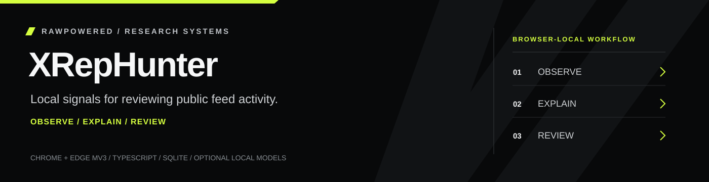
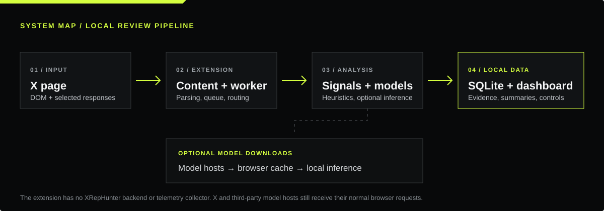
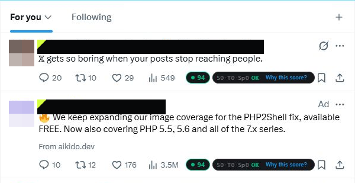
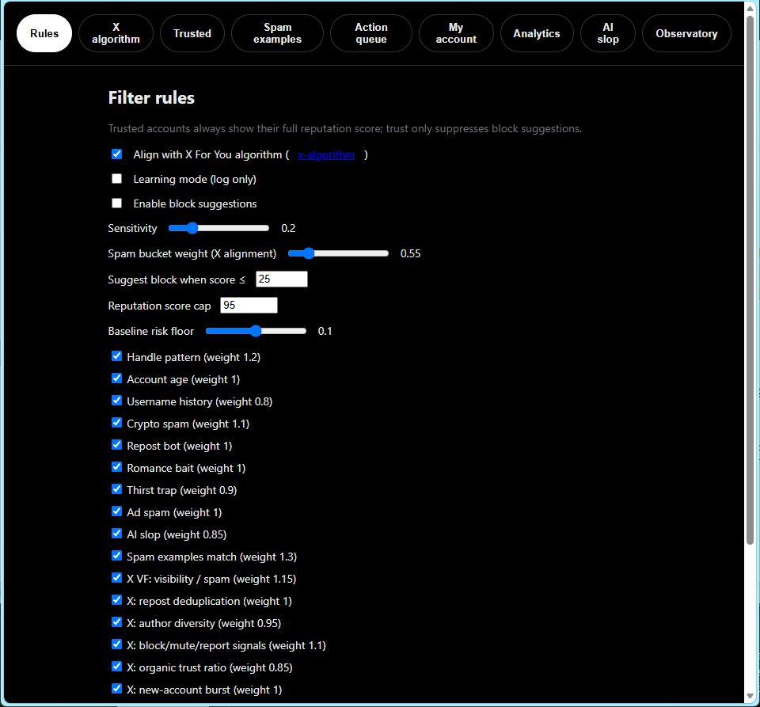

<div align="center">



**A local-first browser extension for inspecting feed signals, account patterns, and browsing activity.**

[Architecture](docs/ARCHITECTURE.md) · [Privacy and security](docs/PRIVACY-AND-SECURITY.md) · [Scoring limits](docs/SCORING-AND-LIMITS.md) · [Build and install](docs/BUILD-AND-INSTALL.md)

Built with TypeScript, WXT, SQLite, Transformers.js, ONNX Runtime Web, and Wllama.

</div>

---

## What XRepHunter does

XRepHunter observes public-facing X and Twitter pages while you browse them. It combines page and GraphQL-derived evidence with configurable local heuristics and optional local model inference. The extension presents review signals in the feed, on profiles, and in a local dashboard.

The project is a research and product prototype. Its scores are prompts for human review. They do not establish a person’s identity, intent, authenticity, or the truth of a post.

## Review paths

| Area | What you can inspect |
| --- | --- |
| **Feed and profile signals** | Reputation summaries, detector explanations, account patterns, post-level spam and content-quality indicators, Community Notes signals, and promoted-post cues. |
| **Content analysis** | Heuristic text analysis, optional local text classifiers, optional image classification, and toxicity signals with adjustable thresholds. |
| **Personal controls** | Trusted accounts, configurable detectors, a spam-example library, learning mode, and an action queue. Block suggestions require an explicit opt-in and per-account confirmation. |
| **Browse Observatory** | Locally aggregated feed observations, topic interests, session activity, interaction patterns, and date-based summaries. |
| **Account analytics** | Import X Account analytics CSV exports, compare saved snapshots, inspect top-post summaries, and export local records. Live analytics can also be observed when the user visits the signed-in analytics page. |
| **Data portability** | Export and import the local SQLite database, plus JSON import and export for spam examples. |

The scoring pipeline includes account and handle patterns, posting and engagement signals, spam examples, sponsorship and repeated-text cues, topic and media signals, and optional model outputs. Explanations expose the evidence that contributed to a result so reviewers can inspect the signal sources.

## System map



The extension uses a Manifest V3 content script and page hook, a background service worker, and an offscreen document for SQLite and model work. The dashboard reads the same extension-local data store.

## Evidence from the running extension

These captures show XRepHunter's feed badges and local rules dashboard in a browser session. Account names and handles are covered, and profile images are pixelated. Scores are review signals from this session, not validated accuracy claims.



*Live-feed review: score badges and the “Why this score?” evidence entry point appear alongside posts.*



*Local dashboard: adjustable signal weights, thresholds, learning mode, and opt-in block suggestions.*

For capture context and redactions, see [Screenshot evidence](docs/SCREENSHOT-EVIDENCE.md).

## Run it locally

Requirements: Node.js with npm, plus Chrome or Edge for loading the unpacked extension.

```sh
npm install
npm run dev
```

For a production build:

```sh
npm run build
```

WXT writes the unpacked build to `extension/`. Open `chrome://extensions` or `edge://extensions`, enable Developer mode, choose **Load unpacked**, and select that folder. The extension runs on `x.com` and `twitter.com` pages. Click the toolbar action to open the dashboard.

The install and build scripts prepare the extension-local ONNX, SQLite, and Wllama runtime files from the locked npm dependencies. Optional model weights are fetched from their model hosts on first use and cached by the browser. Model loading is configurable in the dashboard.

The project includes `npm test` for the Vitest suite and `npm run zip` for packaging the build. See [Build and install](docs/BUILD-AND-INSTALL.md) for the complete setup and distribution notes.

## Data and network behavior

- There is no application server or telemetry endpoint in this project. Extension settings use browser local storage. Observed records and analytics snapshots use a SQLite database persisted in extension storage.
- Text and model inference run in the browser. Model weights are downloaded from Hugging Face when a model is first loaded. ONNX runtime setup can use jsDelivr as a build or runtime fallback.
- Image analysis fetches image URLs from X’s public media hosts when the image classifier is enabled. This is a request for the image itself; it does not upload the text corpus or local database to XRepHunter infrastructure.
- XRepHunter reads pages available to the signed-in browser session. Its page and GraphQL parsing depends on X’s changing web interface. It does not use an X API key or bypass access controls.
- Review [the full data-flow and permission notes](docs/PRIVACY-AND-SECURITY.md) before enabling model features or using the extension with sensitive browsing sessions.

## Evidence and limitations

- Heuristics and classifiers can produce false positives and false negatives. Treat scores as contextual signals, not findings about a person.
- Account labels, content categories, and synthetic-content indicators are uncertain. Review the underlying post, profile, timing, and visible evidence before acting.
- X’s DOM and internal GraphQL response shapes can change. A parser update may be needed when the site changes.
- The account analytics views summarize data available through observed pages or imported CSV files. They are not official X recommendations or guaranteed measurements of the complete account history.
- Block and mute controls interact with the X interface. Suggestions are opt-in, and each action is presented for confirmation.
- The public code is for technical review and evaluation. This repository does not claim a production-ready detector or endorsement by X Corp.

## Project status

XRepHunter is under active development. The repository contains the TypeScript source, extension configuration, tests, build scripts, and project documentation. It is not published through a browser extension store. Confirm current browser compatibility, model availability, and extension behavior in your own review environment.

## Explore the source

- [Architecture and module map](docs/ARCHITECTURE.md)
- [Privacy, permissions, and security boundaries](docs/PRIVACY-AND-SECURITY.md)
- [Signal definitions and model limits](docs/SCORING-AND-LIMITS.md)
- [Build and installation steps](docs/BUILD-AND-INSTALL.md)
- [Third-party notices](THIRD-PARTY-NOTICES.md)
- [Change history](CHANGELOG.md)

## Authorship and rights

Independent project by Joseph Edwards. XRepHunter is not affiliated with or endorsed by X Corp. or any model provider. The original project code and artwork are presented for review; no reuse license is granted. Third-party software and model terms remain with their respective authors and are listed in [Third-party notices](THIRD-PARTY-NOTICES.md).


